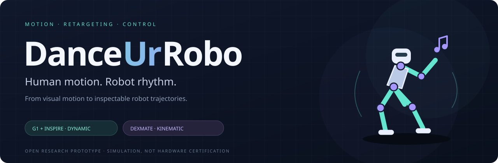
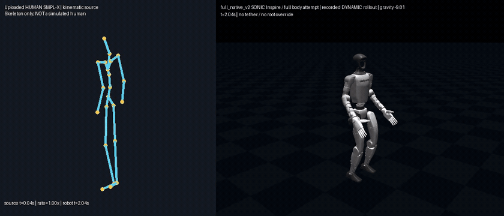

<p align="center"></p>

<p align="center">
  <a href="https://github.com/MrAmazing-h/DanceUrRobo/actions/workflows/ci.yml"></a>
  
  
  <a href="LICENSE"></a>
</p>

<p align="center"><b>Turn human motion into robot motion you can watch, replay, and audit.</b><br>
Two distinct research tracks: G1 whole-body control under gravity, and DexMate kinematic retargeting.</p>

<p align="center">
<a href="#watch-it-dance">Demos</a> ·
<a href="#try-the-g1-pipeline">Quick start</a> ·
<a href="docs/G1.md">G1 method & reproduction</a> ·
<a href="docs/DEXMATE.md">DexMate track</a> ·
<a href="docs/RESULTS.md">Results & limitations</a> ·
<a href="docs/README_CN.md">中文</a>
</p>

## Watch it dance

**Left: uploaded human SMPL-X reference. Right: simulated G1 with Inspire hands.**<br>
Legs, waist, and arms are policy-controlled. Gravity stays on. No tether or root-position override. Finger targets stay neutral.

<p align="center"></p>

<p align="center">
<a href="https://github.com/MrAmazing-h/DanceUrRobo/releases/download/v0.2.0/g1_native_comparison.mp4"><b>▶ Native speed · 24 s</b></a>
&nbsp; / &nbsp;
<a href="https://github.com/MrAmazing-h/DanceUrRobo/releases/download/v0.2.0/g1_half_speed_comparison.mp4"><b>▶ Half speed · 44 s</b></a>
&nbsp; / &nbsp;
<a href="https://github.com/MrAmazing-h/DanceUrRobo/releases/download/v0.2.0/danceurrobo_g1_review.zip">Videos + trajectories</a>
</p>

The GIF shows the dance segment; full videos include initialization and final hold.
This is a **pretrained GEAR-SONIC controller transfer**, not a newly trained policy or an exact reconstruction of the choreography.

> **Research preview, not hardware-ready.** Both recorded full-body trials finish without a fall, but hand self-contact, small joint-limit overshoots, and motion-tracking errors remain. A balance check is not a collision or deployment safety certificate.

<details>
<summary><b>Also included: DexMate Vega-1P/F5D6 kinematic dance</b></summary>

<p align="center"></p>

[Watch DexMate](https://github.com/MrAmazing-h/DanceUrRobo/releases/download/v0.1.0/dexmate_dance.mp4) ·
[Before / after](https://github.com/MrAmazing-h/DanceUrRobo/releases/download/v0.1.0/before_after_robot.mp4) ·
[Complete original documentation](docs/DEXMATE.md)

This older track directly replays qpos in zero gravity. It is **not** the dynamic G1 demonstration above. Its code, data, CLI commands, and v0.1.0 release remain available.
</details>

## Two tracks. Clear contracts.

| | G1 + Inspire | DexMate Vega-1P/F5D6 |
| :--- | :--- | :--- |
| Input | Full-body Z-up SMPL-X | Adapted landmarks + orientation/hand targets |
| Method | SMPL encoder → SONIC policy → joint PD → physics | Anatomical IK → sparse trajectory refinement |
| Output | 50 Hz actual dynamic rollout, 53 hinge joints + floating root | 120 Hz kinematic trajectory |
| Gravity | **On: −9.81 m/s²** | Off |
| Hands | Neutral finger targets | Coupled F5D6 fitting |
| Validation | Single-sequence balance, timing, contract tests; remaining collisions reported | Kinematic metrics and sampled proxy-geometry audit |
| New RL training | None | None |

## Try the G1 pipeline

Linux / Python 3.11 recommended. Downloaded models retain their upstream licenses.
A graphics context is needed only for rendering; inference uses ONNX Runtime CPU.

```bash
git clone https://github.com/MrAmazing-h/DanceUrRobo.git
cd DanceUrRobo
python -m venv .venv
source .venv/bin/activate
pip install -e '.[g1]'

# Public, revision-pinned robot meshes + controller assets; SHA-256 checked.
danceurrobo-fetch --output outputs/g1

# Convert the included derived human-motion sample, not SMPL-X model weights.
danceurrobo-g1 --workdir outputs/g1 \
  --source examples/g1/human_smplx_zup.npz --prepare

# First validate standing, then try a short segment.
MUJOCO_GL=egl danceurrobo-g1 --workdir outputs/g1 --case stand_demo --duration 6
MUJOCO_GL=egl danceurrobo-g1 --workdir outputs/g1 --case dance_smoke --duration 8
# Inspect both before the full motion:
MUJOCO_GL=egl danceurrobo-g1 --workdir outputs/g1 --case dance_native --duration 24
```

Use `--no-render` for a dynamics-only run. CPU-only rendering can use OSMesa when installed.
On a cluster, run simulation inside a compute allocation, not a login node.
Existing case folders are never overwritten. See [full instructions](docs/G1.md), including half-speed runs and output fields.

The distribution name and `dexmate-*` commands remain unchanged for backward compatibility; the project and repository are now **DanceUrRobo**.

## Measured, not just rendered

| Recorded G1 trial | Native speed | Half speed |
| :--- | ---: | ---: |
| Simulation length | 24 s | 44 s |
| Maximum root tilt | 18.34° | 19.19° |
| Falls / non-foot ground contact at sampled states | 0 / 0 | 0 / 0 |
| Maximum sampled joint-limit overshoot | 0.0301 rad | 0.0140 rad |
| Minimum sampled MuJoCo self-contact distance | −12.01 mm | −6.74 mm |

Half speed did **not** improve maximum tilt. These are two trials of **one source sequence**, not a robustness benchmark.
Contact distance is a MuJoCo diagnostic, not independently measured triangle penetration.
See [evaluation details](docs/RESULTS.md) and [machine-readable evidence](results/g1).

## Project map

```text
src/danceurrobo/              # portable G1 full-body controller + verified asset fetcher
src/dexmate_video_retargeting/ # original DexMate IK / refinement / audit pipeline
examples/g1/                 # derived human source and recorded robot motions
examples/inputs/             # frozen DexMate reference targets
assets/                      # README visuals, no learned model weights
results/                     # recorded metrics and reproducibility evidence
docs/                        # methods, input/output contracts and limitations
tests/                       # offline tests; no paid service or hardware required
```

## Credits & development

G1 control builds on [NVIDIA GEAR-SONIC / GR00T WholeBodyControl](https://github.com/NVlabs/GR00T-WholeBodyControl) and [Unitree robot descriptions](https://github.com/unitreerobotics/unitree_ros).
DexMate assets originate from [Dexmate](https://github.com/dexmate-ai/dexmate-urdf).
Human reconstruction uses the optional [GVHMR / SMPL-X workflow](docs/VIDEO_WORKFLOW.md).
This is an independent project, not an official release from those teams.

Original project code is MIT. Model weights, robot descriptions, and third-party assets retain their own terms; see [notices](THIRD_PARTY_NOTICES.md). No model weights, licensed SMPL-X body-model files, source person video, or soundtrack are committed.

```bash
pip install -e '.[dev]'
ruff check .
ruff format --check .
pytest -q
python -m build
```
