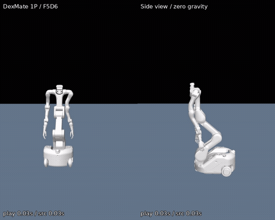

# DexMate Video Retargeting

**From monocular human motion to a planar mobile robot: anatomical IK, offline trajectory refinement, and independently audited 120 Hz replay.**

[](https://github.com/MrAmazing-h/DanceUrRobo/actions/workflows/ci.yml)
[](../LICENSE)
[](../pyproject.toml)

<p align="center"></p>

[Watch / download the robot demonstration](https://github.com/MrAmazing-h/DanceUrRobo/releases/download/v0.1.0/dexmate_dance.mp4) · [Before / after video](https://github.com/MrAmazing-h/DanceUrRobo/releases/download/v0.1.0/before_after_robot.mp4) · [Method](METHOD.md) · [New video workflow](VIDEO_WORKFLOW.md) · [Reproduction](REPRODUCIBILITY.md)

This repository releases the custom Vega-1P/F5D6 retargeting and refinement code behind a demonstrated dance sequence. It reuses GVHMR human motion reconstruction and optional MediaPipe hand observations, then fits robot-proportioned upper-body landmarks and chest, palm and head orientations. The optimization handles a planar mobile base, a serial three-joint torso, two seven-joint arms and coupled F5D6 hands.

**Scope:** zero-gravity kinematic playback. There is no RL policy, torque controller, wheel-command decoder, dynamic balance evaluation or hardware validation. Human poses and hidden fingers are estimates. The collision result is specific to the released proxy geometry, pair exclusions and sampling schedule.

## Replay and evaluate the released trajectory

Linux, Python 3.11 recommended. Python 3.12 is covered by CI; macOS and Windows are not validated.

```bash
git clone https://github.com/MrAmazing-h/DanceUrRobo.git
cd DanceUrRobo
python -m venv .venv
source .venv/bin/activate
pip install -e '.[dev]'
dexmate-fetch-model --output external
python scripts/prepare_example.py --model-dir external/vega_1p_f5d6 --output outputs/demo
dexmate-quality --inputs examples/inputs --run outputs/demo
dexmate-audit --run outputs/demo --output outputs/demo/evaluation/interpolation_audit.json --substeps 64
MUJOCO_GL=egl dexmate-render --run outputs/demo --bounds-run outputs/demo --output outputs/demo/videos
```

Use `MUJOCO_GL=osmesa` on CPU-only Linux with OSMesa installed, or the default GLFW backend on a desktop. The renderer directly assigns qpos; no physics step is performed. The model download is the same SHA-256 checked 14.2 MB robot conversion used by [DexMate Writing](https://github.com/MrAmazing-h/dexmate-writing).

## Re-run the optimization

The frozen input bundle includes robot-proportioned landmarks, body orientation targets, the original F5D6 seed and hand-observation flags. It contains no human body-model weights or source video. This allows the released optimization to run without GVHMR or a private retargeting repository.

```bash
OPENBLAS_NUM_THREADS=1 OMP_NUM_THREADS=1 python scripts/reproduce.py --model-dir external/vega_1p_f5d6 --output outputs/reproduction
```

This runs anatomical IK, offline sparse SQP refinements, 120 Hz PCHIP export, dense collision auditing, optional local clearance correction and final metrics. Expect several CPU minutes or longer, depending on machine and BLAS. The original initial seed was produced by an earlier Laplacian/SQP retargeter; it is supplied as data. The public pipeline does not claim to reproduce that earlier solver from scratch. A new-video adapter using neutral or user-provided initialization is included separately.

The before/after video shows the previous trajectory in the left pair of views and the refined trajectory in the right pair.

## Recorded single-sequence comparison

The two columns use the same 590 estimated, proportion-adapted source frames at 30 Hz. The final robot motion has 2,360 frames at 120 Hz. This is a before/after development comparison, not a multi-sequence benchmark or a controlled ablation.

| Metric ↓ | Previous trajectory | Refined trajectory |
| :--- | ---: | ---: |
| Mean wrist position error (cm) | 3.325 | 2.514 |
| Mean chest orientation error (deg) | 48.676 | 4.953 |
| Mean left palm orientation error (deg) | 16.471 | 6.714 |
| Mean right palm orientation error (deg) | 83.106 | 5.147 |
| Mean head orientation error (deg) | 53.878 | 2.273 |
| Mean absolute hinge acceleration at common 30 Hz (rad/s²) | 9.488 | 5.629 |
| Mean absolute hinge jerk at common 30 Hz (rad/s³) | 347.648 | 92.888 |

Worst-frame errors remain material: final wrist error reaches **17.159 cm**, and palm error reaches **45.145°**. Means do not imply every pose is accurate. The recorded 148,617 intermediate collision samples found no tolerance violations; the public audit additionally includes saved poses and treats excessive ground penetration as failure. See [raw before/after metrics](../results), [metric definitions](METRICS.md), and [release validation](../results/release_validation.json).

Release validation re-ran the entire selected optimization path: all four sparse stages and the final 120 Hz qpos matched the recorded output bit for bit in the tested environment. Final metrics also matched, and 150,977 audited pose samples passed. This is an environment-specific reproduction result, not a cross-platform numerical guarantee.

## New inputs and hand motion

[The video workflow](VIDEO_WORKFLOW.md) documents GVHMR setup, video timing, 2D review, Z-up SMPL-X export, robot-proportion adaptation, optional MediaPipe hand tracking/crops, and F5D6 fitting. Body estimation and hand estimation use separate environments to avoid upstream dependency conflicts. Download licensed SMPL-X assets yourself; they are not redistributed.

Hidden hands cannot be recovered uniquely from one video. Missing hand observations retain `observed=false`; short gaps interpolate and longer gaps hold the previous observed shape. A visually plausible pose is not proof of recovered human articulation.

## Structure

```text
src/dexmate_video_retargeting/
  prepare_targets.py       # morphological landmark and body-frame adapter
  posture_ik.py            # framewise MuJoCo Jacobian / OSQP IK
  batch_refine.py          # sparse trajectory SQP and sampled collision constraints
  fit_hands.py             # coupled F5D6 finger fitting and collision contraction
  upsample_review.py       # PCHIP joints and unwrapped planar yaw
  polish_local_clearance.py
  audit.py                 # independent pose and transition checks
  quality_metrics.py       # frozen-reference kinematic diagnostics
  render.py
scripts/                   # example/reproduction and optional perception adapters
examples/                  # recorded robot motions and frozen solver inputs
results/                   # complete metrics, configurations and release checks
docs/                      # method, contracts, setup and limitations
```

## Development and attribution

```bash
ruff check .
ruff format --check .
pytest -q
python -m build
```

Original code: MIT. Robot descriptions/meshes: Dexmate Inc., Apache 2.0. Optional GVHMR, SMPL-X, MediaPipe and their assets retain their own terms. GMR and WARP motivated orientation and limb-structure objectives; this is **not an official implementation or benchmark of either method**. See [third-party notices](../THIRD_PARTY_NOTICES.md), [software citation](../CITATION.cff) and [contribution guidelines](../CONTRIBUTING.md).
